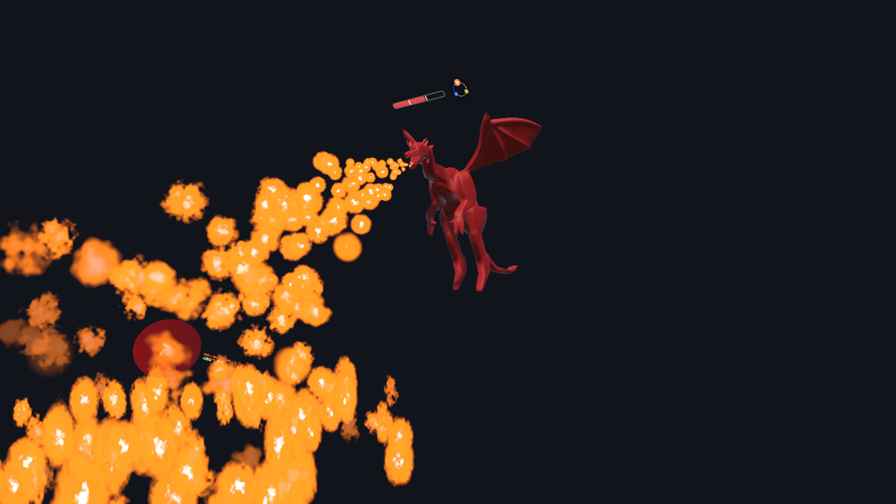
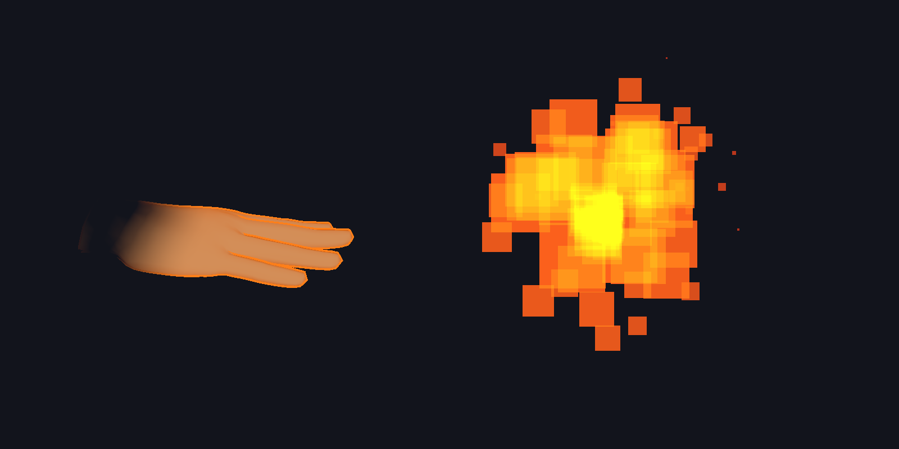
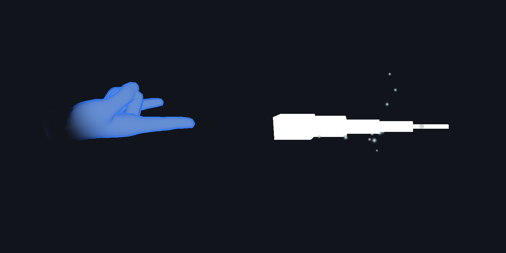
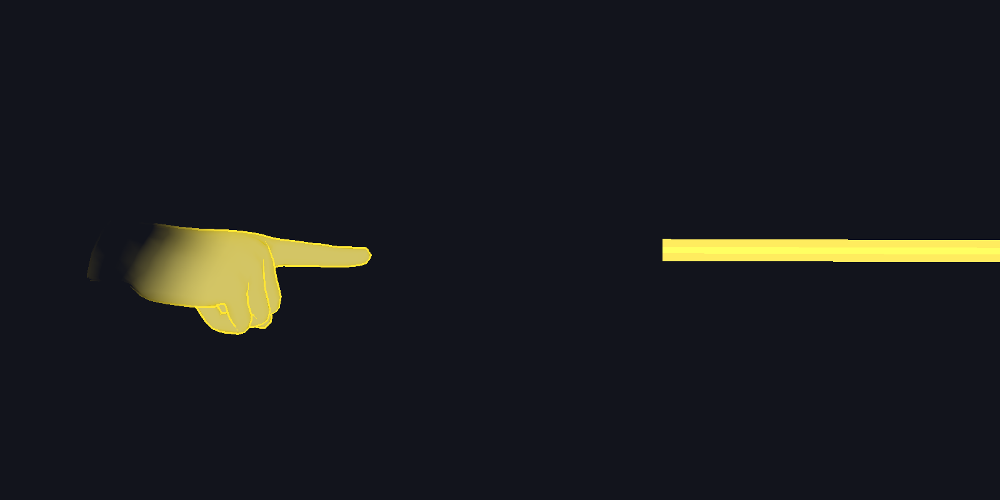
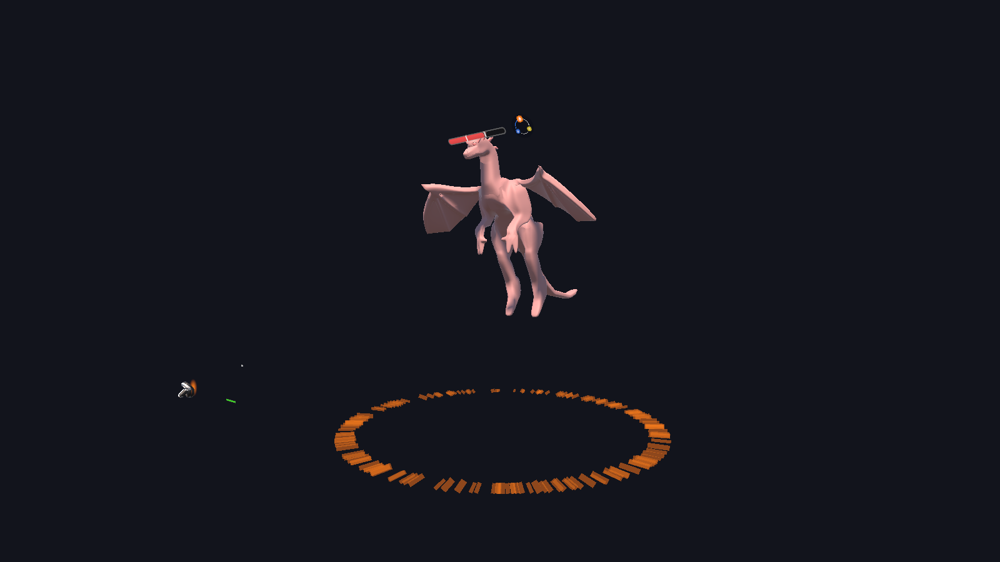
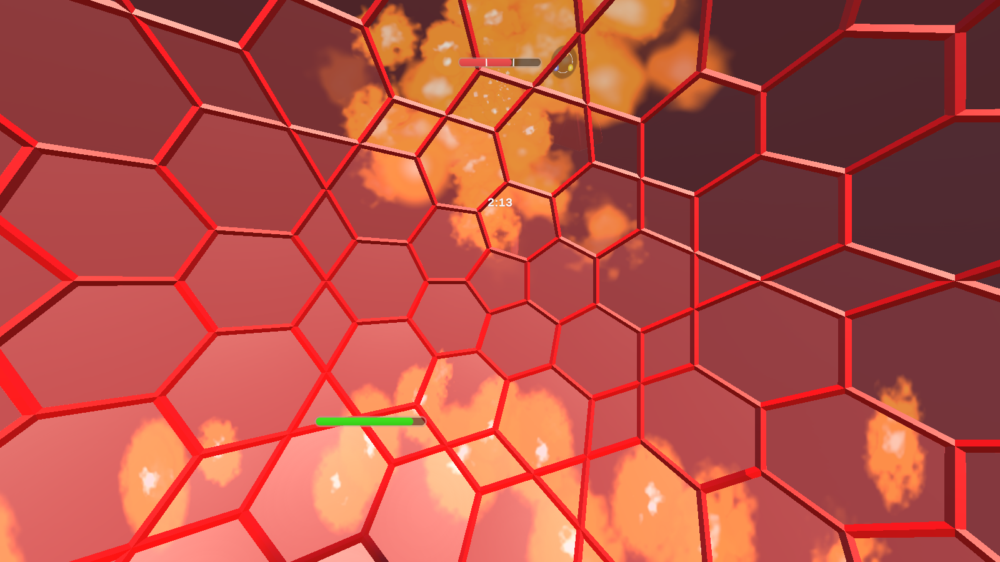
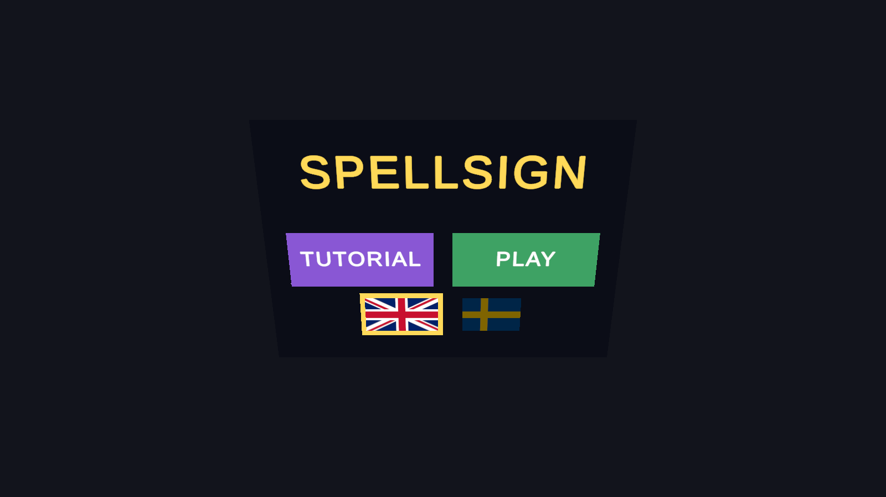
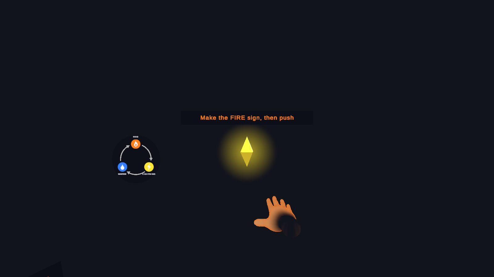

# SpellSign

A mixed reality boss fight for Meta Quest 3. You cast spells with hand signs, and you block the dragon's breath by holding up shapes you drew on a real whiteboard. The dragon fights you in your actual room.

SpellSign was made for the course DH2413 Advanced Graphics and Interaction at KTH (2026). It was also shown as a museum installation, where most players were children with two to three minutes each.

## How to play

### Cast spells with your hands

Make a sign with either hand, then push it forward to cast. Your hand glows in the spell's colour while the sign is held.

| Spell | Sign | |
|---|---|---|
| **Fire**: a fireball | Open hand, all fingers straight |  |
| **Water**: an icicle | Index and pinky out, palm up |  |
| **Lightning**: a bolt | Point with the index finger |  |

### Use the right element

The elements beat each other in a circle: **Water beats Fire, Fire beats Lightning, Lightning beats Water.**

- The element that beats the dragon does double damage.
- Any other element does normal damage.
- The dragon's own element does nothing.
- A hit to the head counts twice.

The dragon starts as Water. It turns into Fire and then Lightning as it loses health. Each time, it flashes white and changes colour, and particles swirl into it. The element ring next to its health bar shows its current element and what beats it.

### Survive the dragon

The dragon's shots match its element: fireballs, water bolts and lightning orbs. You dodge them by moving your body.

Its **breath attack** can't be dodged. The game warns you first and names the shield you need. Hold the matching drawing up to the headset's camera to raise a shield of the same element as the dragon:

| Drawing | Shield |
|---|---|
| Circle | Water |
| Triangle | Fire |
| Line | Lightning |

A fight lasts at most 2 minutes 30 seconds. It ends in victory, defeat or **TIME'S UP**.

### Tutorial and menus

The tutorial teaches each sign by having you break crystals. A see-through hand shows the sign to make. It then teaches the element circle, and finally the shields.

The start menu has TUTORIAL and PLAY buttons, and flags for switching between English and Swedish. You press the buttons with your fingertip.

| Start menu | Tutorial |
|---|---|
|  |  |

The screenshots were taken in the Unity editor, so they have a dark background instead of the room you see through the headset.

## Requirements

- **Headset:** Meta Quest 3 or 3S on Horizon OS v74 or later. The shields need the Passthrough Camera API.
  - Developer mode on.
  - Hand tracking on.
  - A room scan, made in Space Setup.
- **Unity:** Unity **6000.6.0f1** with Android Build Support.
- **Whiteboard:** a whiteboard and a marker for the shield drawings.
  - The game only reads shapes while it can see four AprilTags on the board's corners.
  - Tags: family `tagStandard41h12`, IDs 0 to 3 for top left, top right, bottom left and bottom right, about 4 cm wide.

## Getting started

1. Clone the repository and open the project in Unity Hub with Unity 6000.6.0f1.
2. Open `Assets/Scenes/MainScene.unity`.
3. In **File > Build Profiles**, choose **Meta Quest** and make it the active profile.
4. Connect the headset over USB and select **Build And Run**.
5. On first launch, allow the headset to use spatial data and the camera.

## Project structure

| Folder | What's in it |
|---|---|
| `Assets/` (root scripts) | Hand sign recognition and casting (`HandGestureRecognizer`, `SpellPoseDefinition`), the player's spells, the dragon (`DragonBoss`, `EnemyTarget`), and the element rules (`Element`) |
| `Assets/BossAttacks/` | The dragon's projectiles, lightning arcs and the breath's flame shader |
| `Assets/Sigils/` | Reading drawings from the headset camera: board detection, shape classification and the shield |
| `Assets/Menu/` | Start and end menus, touch buttons, the fight timer and the game flow |
| `Assets/Tutorial/` | Tutorial steps, crystals and the see-through hand |
| `Assets/CombatFeedback/` | Health bars, damage numbers, the element ring and hit effects |
| `Assets/Localization/` | Language switching. Every text in the game is in `Resources/Translations.csv` |
| `Assets/Scenes/` | `MainScene`, the game |

## Branches

- **`main`** is the full game. The start menu also has a SANDBOX practice mode and a choice of whether spells stop at the room's walls.
- **`museum-demo`** is the exhibition version. It has no developer buttons, and spells always go through walls.

## Notes for contributors

- **Machine-specific files:** `Assets/Resources/DevAgentSettings.asset` and `Assets/Settings/Build Profiles/Meta Quest.asset` change on every machine. Don't commit them.
- **Translations:** new player-facing text goes in `Translations.csv`, in both English and Swedish.

## Built with

- Unity 6 (Universal Render Pipeline)
- Meta XR SDK: hand tracking, MR Utility Kit and the Passthrough Camera API
- OpenXR
- [jp.keijiro.apriltag](https://github.com/keijiro/jp.keijiro.apriltag) for whiteboard detection

## Team

| Member | Main contributions |
|---|---|
| Deyan Papazov | Hand-sign casting, spells, the dragon's attacks and transformation, tutorial, menus and HUD, languages |
| Isac Ljungberg | Dragon model and animations, elemental shields |
| Richard Zhang | Element phases, gesture smoothing, whiteboard tag detection, menus, headshots |
| Iasonaschron | Shape recognition from the headset camera, shields, combat feedback, walls setting |
